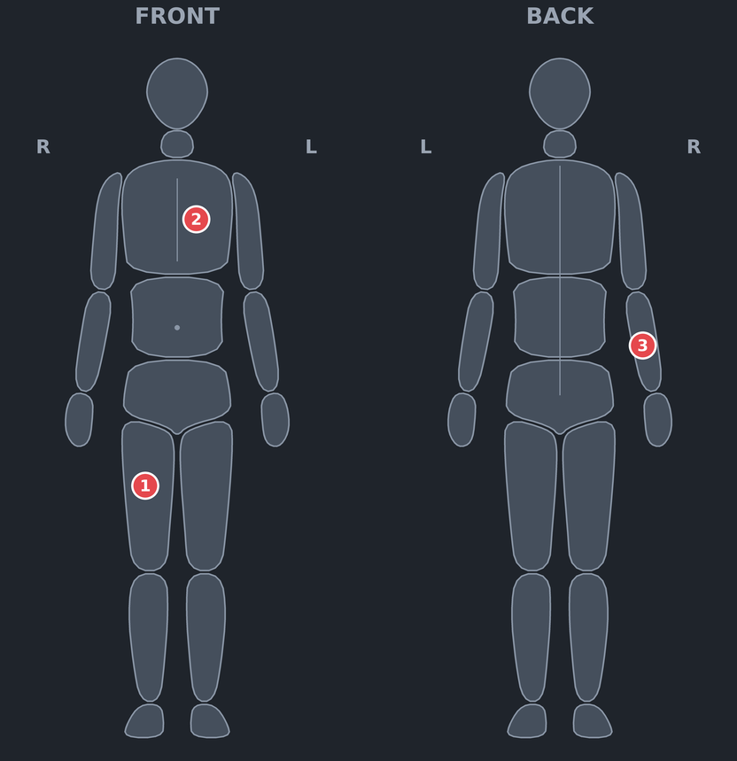
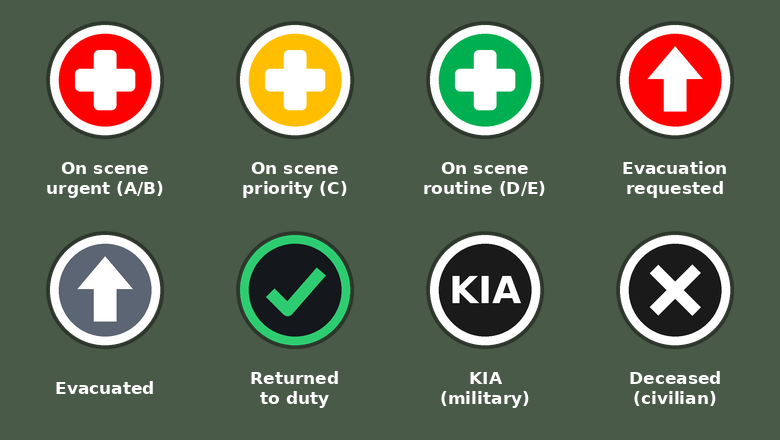

# CasualtyKit for TAK

An ATAK plugin for casualty reporting: a digital TCCC card (DD Form 1380), MARCH treatments,
a vital-signs log with alerts, MIST reports, and 9-line MEDEVAC requests built from the cards.
Everything is shared with the team as standard Cursor-on-Target (CoT).

> **Status: early test build (v0.4).** The code compiles against the ATAK-CIV 5.5.0 SDK, the tak.gov
> pipeline has built and signed it for ATAK 5.8.0, and the core logic is unit-tested. Device testing
> so far is brief and informal. This software is unvalidated and is **not a medical device**.

## What it does

- **Casualty list**, most urgent first, colour-coded by evacuation precedence.
- **TCCC card**: identity, precedence, mechanism and time of injury, injuries, vital signs,
  treatments grouped by MARCH, notes.
- **Body diagram**: tap the front or back figure to record where the casualty is injured.
- **Tourniquet clock**: time-on for every tourniquet, shown on the list and the card.
- **Map markers**: each card is a marker with the MIST report in its remarks. With the plugin the
  marker is a status icon (below); any other TAK client sees a coloured dot.
- **Statuses**: active, evacuation requested, evacuated, returned to duty, KIA (military) and
  deceased (civilian). The dead are left out of 9-line requests.
- **Team sync**: cards merge across devices; the most recent edit wins on every device.
- **Alerts** when a received or entered set of vitals crosses the configured limits.
- **9-line MEDEVAC**: lines 3, 5 and 8 are filled in from the selected cards. The request is sent in
  the stock ATAK CASEVAC format, so clients without the plugin open it in their built-in tool.

## Screens and symbols

Body diagram used on the card. Regions are tapped by their outline; numbered markers match the injury list.

Map marker icons. Colour is the evacuation precedence, the symbol is the status.

These two pictures are design previews drawn from the plugin's geometry and colours, not device screenshots.

## Platforms

| Platform | State |
|---|---|
| ATAK (Android) | v0.4, this repository |
| WinTAK (Windows) | Planned. Will share the CoT format in [`docs/COT-SPEC.md`](docs/COT-SPEC.md) |
| iTAK (iOS) | No plugin planned; iTAK users see the markers and MIST text |

## Repository layout

| Path | Contents |
|---|---|
| `app/` | The ATAK plugin: UI, storage, map and network glue |
| `core/` | Platform-neutral logic and CoT codec, plain Java with unit tests |
| `docs/COT-SPEC.md` | The wire format shared by all platforms |
| `docs/user_manual/` | User manual source (Typst), built by the TAK pipeline |
| `docs/TAKGOV_README.md` | README in the layout the tak.gov pipeline expects |
| `scripts/package-submission.sh` | Builds the source zip for tak.gov signing |

## Building

The ATAK SDK is not included and cannot be redistributed. Download it from [tak.gov](https://tak.gov).

1. Clone this repository into `<ATAK SDK>/samples/casualtykit`.
2. Create `local.properties` containing `sdk.dir=<path to your Android SDK>`.
3. Set `ext.ATAK_VERSION` in `app/build.gradle` to the version of your SDK.
4. Run `./gradlew assembleCivDebug`.

A debug build loads only in the developer build of ATAK that ships with the SDK (`atak.apk`).

Core tests need no SDK:

    ./gradlew -p core test

## Running on ATAK from Google Play

Release ATAK only loads plugins signed by the TAK Product Center. Build the submission zip and
upload it at <https://tak.gov/user_builds>:

    scripts/package-submission.sh 5.8.0

Raise `takStaticVersion` in `gradle.properties` for every submission.

## Known limits

- Vital-sign alert limits in `VitalsAlerts` are placeholders and must be set by a medical lead.
- Cards are stored under `atak/tools/casualtykit/` through ATAK's IO provider. Unless ATAK is
  configured with an encrypting provider, they are plain text on the device.
- Deleting a marker on the map does not delete the card.
- The interface is English only.
- No reading of vitals from wearables yet.

## Licence

No licence has been chosen yet. Build files under `app/`, `gradle/` and `docs/user_manual/` derive
from the ATAK plugin template and remain under its terms.
